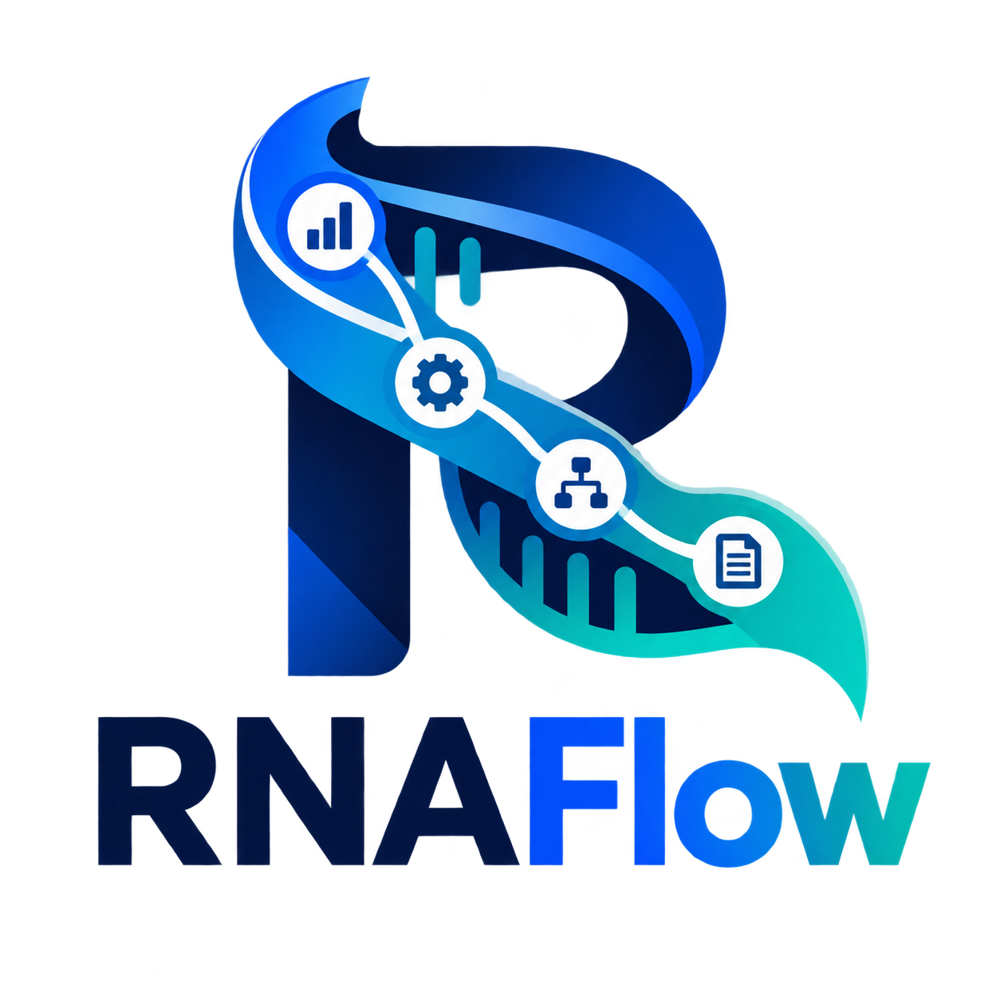

<p align="center">
  
</p>

# RNAFlow - RNA-seq Analysis Pipeline

[中文版本 (Chinese Version)](docs/README_zh.md)

RNAFlow is a fully automated RNA-seq analysis pipeline based on Snakemake. It implements an end-to-end closed-loop analysis from **Raw Data** to **Standardized Bioinformatics Reports (Interactive Report)**, and finally to **AI-powered results interpretation**.

> **License**: RNAFlow is open-source software released under the MIT License. See [LICENSE](./LICENSE) for details.

## 🧩 Built on FlowFrame

RNAFlow is developed on the [FlowFrame](https://github.com/xsx123123/FlowFrame) specification for multi-omics workflow development. FlowFrame standardizes the pipeline entrypoint, directory layout, configuration and schema validation, module dependency and target generation, data gating, resource management, and delivery/report interfaces. RNAFlow applies these conventions to RNA-seq, combining them with its transcriptome-specific toolchain and the external BioReport reporting system.

## 📖 Documentation

Detailed guides have been split out of this README:

| Guide | Contents |
|-------|----------|
| [Installation](docs/installation.md) | Prerequisites, repository setup, Snakemake environment |
| [Container Image Builder](docs/container_builder.md) | Build Docker images from Conda environments, batch build and push |
| [Architecture & Project Layout](docs/architecture.md) | System architecture, data flow, recommended project directories, codebase map |
| [Configuration](docs/configuration.md) | `config.yaml`, sample/contrast tables, module switches, internal and cluster configs |
| [Usage & Analysis Modules](docs/usage.md) | Running the pipeline, per-module behavior, typical scenarios, report export |
| [Reference Genome Builder](docs/reference_builder.md) | Build STAR/RSEM indexes and generate `reference.yaml` snippets |
| [AI Skills](docs/ai_skills.md) | Install and use RNAFlow skills with Claude Code / Codex |
| [MCP Server](docs/mcp_server.md) | Genome query, config generation, run management, remote deployment |
| [Version History](docs/version_history.md) | Release notes for every RNAFlow version |
| [Roadmap](docs/ROADMAP.md) | Planned analysis extensions and platform features |

## ✨ Core Features

- **High Scalability**: Supports distributed task scheduling and adapts to cluster environments such as Slurm and PBS, with Huawei Donau clusters supported through the `snakemake_executor_donau` plugin, enabling large-scale parallel sample processing.
- **Portability**: Automatically manages all toolchains via Conda/Mamba, ensuring complete consistency between code and environment for reproducible analysis and "painless" migration.
- **Modularity**: Based on Snakemake rules, analysis steps (QC, mapping, differential analysis, etc.) are logically decoupled, facilitating customized combinations and secondary development.
- **High Transparency**: Built-in full-process MD5 verification, execution status monitoring (Benchmark), and detailed logging system ensure the analysis process is traceable and data is auditable.
- **Automated Reporting**: Automatically aggregates MultiQC and organizes the delivery directory; results are exported as a versioned `project_summary.json` for [BioReport](https://github.com/xsx123123/bioreport), the reporting component of the CygnusX BioOps ecosystem, which generates HTML and PDF reports.
- **AI-Powered Interpretation**: BioReport integrates production-grade AI engines (e.g., Doubao, Qwen) to automatically transform complex differential genes and enrichment results into easy-to-understand biological insights.

## 🛠 Analysis Workflow

RNAFlow covers the standard whole process of transcriptome analysis:

1.  **QC & Cleaning**: FastQC quality control -> fastp filtering and adapter removal.
2.  **Contamination Check**: Detection of species contamination (FastQ Screen).
3.  **Mapping**: STAR high-performance alignment -> Qualimap/Samtools statistics -> Preseq library complexity / RSeQC integrity assessment.
    *   **STAR Parameter Optimization**:
        *   `--peOverlapNbasesMin 0`: Uses default overlap threshold for paired-end reads merging (disabled by default).
        *   `--peOverlapMMp 0.1`: Allows 10% mismatch in the overlap area, increasing the merging success rate in the presence of sequencing errors or SNPs.
        *   `--twopassMode Basic`: Enables two-pass mapping mode. Splice sites discovered in the first pass are used to guide the second pass, greatly improving the identification accuracy of junctions.
        *   `--outFilterMismatchNoverLmax 0.04`: Limits the mismatch rate to within 4% (only 6 mismatches allowed for 150bp), much stricter than the default 30%, effectively reducing false positive alignments.
        *   `--alignMatesGapMax 1000000`: Allows gaps up to 1Mb between paired-end reads, which is necessary for identifying long introns in eukaryotes.
        *   `--chimSegmentMin 12`: Sets the minimum segment length to 12bp, enabling STAR to search for and report cross-chromosomal fusion signals.
        *   `--quantMode TranscriptomeSAM`: Directly generates BAM files aligned to the transcriptome, facilitating subsequent quantification using RSEM or Salmon.
4.  **Quantification**: RSEM gene/transcript level expression quantification.
5.  **Advanced Analysis**:
    *   **DEG**: Differential expression analysis based on DESeq2.
    *   **Enrichment**: GO/KEGG functional enrichment analysis.
    *   **Splicing**: rMATS alternative splicing detection.
    *   **Fusion**: Arriba fusion gene identification.
    *   **Variants**: GATK single nucleotide variant detection.
    *   **Assembly**: StringTie transcript assembly.
6.  **Reporting & Delivery**: Automatically aggregates MultiQC, organizes the delivery directory, and hands results to the [BioReport](https://github.com/xsx123123/bioreport) component of the CygnusX BioOps ecosystem for HTML and PDF report generation.

## 🚀 Quick Start

### 1. Clone and install

```bash
git clone --recurse-submodules git@github.com:xsx123123/RNAFlow.git
cd RNAFlow
conda install -c conda-forge -c bioconda snakemake mamba
pip install "snakemake_logger_plugin_rich_loguru>=0.3.0"
```

The analysis toolchains are managed by Conda environments defined under `envs/` and are created automatically on first run. See [Installation](docs/installation.md) for details.

### 2. Configure the project

Copy `examples/analysisyaml.example.yaml` and set at least the paths and module switches:

```yaml
project_name: 'PRJNA1224991'
Genome_Version: "Lsat_Salinas_v11"
raw_data_path:
  - /path/to/raw_data
sample_csv: /path/to/samples.csv
paired_csv: /path/to/contrasts.csv
workflow: /path/to/analysis_dir
data_deliver: /path/to/deliver_dir
execution_mode: local
Library_Types: fr-firststrand
only_qc: false
deg: true
```

The full option reference, sample table formats, and cluster settings are in [Configuration](docs/configuration.md).

### 3. Run

```bash
# Dry run
snakemake -n --config analysisyaml=/path/to/your_config.yaml

# Full run
snakemake --cores 60 -p \
    --use-conda --conda-frontend mamba \
    --rerun-triggers mtime \
    --logger rich-loguru \
    --config analysisyaml=/path/to/your_config.yaml
```

Module behavior and typical analysis scenarios are described in [Usage & Analysis Modules](docs/usage.md).

## 📂 Repository at a Glance

```text
RNAFlow/
├── snakefile                # Main Snakemake entry file
├── config/                  # Global, reference, parameter, and cluster configs
├── rules/                   # Modular rule definitions (01-14)
├── envs/                    # Conda environment definitions
├── src/                     # Auxiliary Python/R script libraries (submodule)
├── report/                  # BioReport submodule
├── skills/                  # AI Skills
├── mcp/                     # MCP server
├── container_env/           # Container image builder (submodule)
├── build_reference/         # Reference genome index builder
└── docs/                    # Documentation
```

See [Architecture & Project Layout](docs/architecture.md) for the full system diagram and recommended data directories.

## 📌 Versioning Strategy

RNAFlow adopts a **multi-component independent versioning** strategy. Each major component has its own version number to reflect its independent iteration cycle:

| Component | Current Version | Description |
|-----------|----------------|-------------|
| **RNAFlow Pipeline** | `v0.2.0` | Core Snakemake workflow (QC, mapping, quantification, DEG, etc.) |
| **RNAFlow-MCP Server** | `v0.2.0` | MCP server for AI assistant integration (independent release cycle) |
| **rnaflow-cli (Deliver Tool)** | `v0.2.0` | Rust-accelerated data delivery CLI (independent release cycle) |
| **BioReport** | Independent | External reporting system in the [bioreport](https://github.com/xsx123123/bioreport) repository (CygnusX BioOps) |

> **Note**: The Pipeline version (`v0.2.0`) is the authoritative version for the overall analysis workflow. MCP Server and Deliver Tool versions may differ as they are released on separate schedules.

## 📅 Development Roadmap

Planned analysis extensions, LncRNA and cloud-native reference management, advanced experimental design, and AI engine enhancements are tracked in [docs/ROADMAP.md](docs/ROADMAP.md).

## 📈 Latest Release

### RNAFlow_v0.2.0 (2026-10-20)
- **Version**: Updated the Pipeline version from v0.1.9 to v0.2.0 in the default configuration, report module manifest, workflow headers, and example configurations.
- **Documentation**: Synchronized current-version references and clarified that roadmap features remain planned work. MCP Server and Deliver Tool retain their independent versions.

Full release notes are available in [Version History](docs/version_history.md).

---
**Author**: JZHANG | **Version**: RNAFlow_v0.2.0

---

<p align="center">
  
</p>
