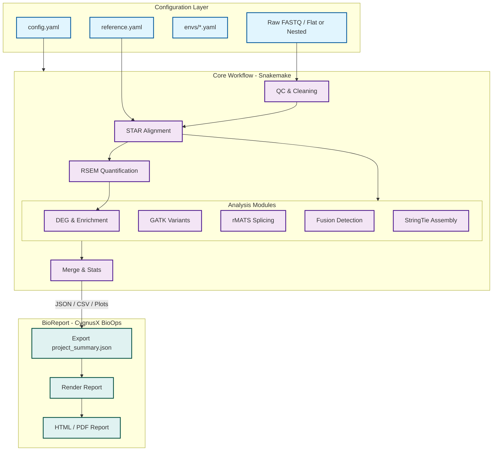

<p align="center">
  
</p>

# RNAFlow - RNA-seq Analysis Pipeline

[English Version](../README.md)

RNAFlow 是一个基于 Snakemake 的全自动化 RNA-seq 分析流程。它实现了从**原始测序数据 (Raw Data)** 到**标准化生物信息报告 (Interactive Report)**，再到 **AI 智能结果解读** 的端到端闭环分析。
> **开源协议**：RNAFlow 采用 MIT 协议开源。详情请参见 [LICENSE](../LICENSE)。

## 🧩 基于 FlowFrame 构建

RNAFlow 基于 [FlowFrame](https://github.com/xsx123123/FlowFrame) 多组学流程开发规范构建。FlowFrame 统一了流程入口、目录结构、配置与 Schema 校验、模块依赖与目标生成、数据准入、资源管理以及交付/报告接口；RNAFlow 在这些规范之上实现 RNA-seq 专属分析工具链与外部 BioReport 报告系统。

## 📖 目录
- [基于 FlowFrame 构建](#-基于-flowframe-构建)
- [核心特性](#-核心特性)
- [分析工作流](#-分析工作流)
- [系统架构](#-系统架构-system-architecture)
- [项目组织建议](#-项目组织建议-project-organization)
- [安装指南](#-安装指南)
- [参考基因组构建](#-参考基因组构建)
- [AI Skills 使用指南](#-ai-skills-使用指南)
- [配置指南](#-配置指南-configuration)
- [使用说明](#-使用说明)
- [开发计划](ROADMAP_zh.md)
- [版本历史](#-版本历史)

## ✨ 核心特性

- **高可扩展性 (High Scalability)**：支持分布式任务调度，完美适配集群环境（如 Slurm、PBS），并可通过 `snakemake_executor_donau` 插件兼容华为多瑙集群，实现大规模样本并行处理。
- **可迁移性 (Portability)**：通过 Conda/Mamba 自动管理所有工具链，实现代码与环境的完全一致，确保分析的可复现性与"无痛"迁移。
- **模块化设计 (Modularity)**：基于 Snakemake 规则，各分析环节（QC、比对、差异分析等）逻辑解耦，便于定制化组合与二次开发。
- **高度透明 (Transparency)**：内置全流程 MD5 校验、运行状态监控（Benchmark）与详实的日志系统，确保分析过程可回溯、数据可审计。
- **自动报告 (Automated Reporting)**：自动汇总 MultiQC 并整理交付目录；分析结果以版本化的 `project_summary.json` 导出，交由 CygnusX BioOps 生态的 [BioReport](https://github.com/xsx123123/bioreport) 生成 HTML 与 PDF 报告。
- **AI 智能解读 (AI-Powered)**：BioReport 集成生产级 AI 引擎（如豆包、通义千问），自动将复杂的差异基因和富集结果转化为易于理解的生物学洞察。

## 🛠 分析工作流

RNAFlow 涵盖了标准的转录组分析全过程：

1.  **QC & Cleaning**: FastQC 质控 -> fastp 过滤与去接头。
2.  **Contamination Check**: 检测物种污染（FastQ Screen）。
3.  **Mapping**: STAR 高性能比对 -> Qualimap/Samtools 统计 -> Preseq 文库复杂度 / RSeQC 完整性评估。
    *   **STAR 参数优化**:
        *   `--peOverlapNbasesMin 0`: 使用默认阈值进行双端 Read 重叠合并（默认禁用）。
        *   `--peOverlapMMp 0.1`: 允许重叠区域存在 10% 的错配，提高了在有测序误差或 SNP 存在时的合并成功率。
        *   `--twopassMode Basic`: 开启两轮比对模式，第一轮发现的剪接位点会用于指导第二轮比对，极大提升了拼接位点（Junctions）的识别精度。
        *   `--outFilterMismatchNoverLmax 0.04`: 将错配率限制在 4% 以内（150bp 仅允许 6 个错配），比默认的 30% 严格得多，有效减少假阳性比对。
        *   `--alignMatesGapMax 1000000`: 允许双端 Read 之间存在长达 1Mb 的间隙，这是识别真核生物长内含子所必需的。
        *   `--chimSegmentMin 12`: 设定最小段长度为 12bp，使 STAR 能够搜寻并报告跨染色体的融合信号。
        *   `--quantMode TranscriptomeSAM`: 直接生成比对到转录本的 BAM 文件，方便后续使用 RSEM 或 Salmon 进行定量。
4.  **Quantification**: RSEM 基因/转录本水平表达定量。
5.  **Advanced Analysis**:
    *   **DEG**: 基于 DESeq2 的差异表达分析。
    *   **Enrichment**: GO/KEGG 功能富集分析。
    *   **Splicing**: rMATS 可变剪接检测。
    *   **Fusion**: Arriba 融合基因鉴定。
    *   **Variants**: GATK 单核苷酸变异检测。
    *   **Assembly**: StringTie 脚本组装。
6.  **Reporting & Delivery**: 自动汇总 MultiQC，整理交付目录，并交由 CygnusX BioOps 生态的 [BioReport](https://github.com/xsx123123/bioreport) 生成 HTML 与 PDF 报告。

## 🏗️ 系统架构 (System Architecture)



### 🔄 核心数据流说明
1.  **输入解析**: `Snakemake` 自动读取 `config.yaml` 并识别输入数据结构。
2.  **核心计算**: 通过 STAR + RSEM 获得表达矩阵，并行触发高级分析模块。
3.  **结果汇聚**: `15.deliver.smk` 将关键结果汇总到交付目录。
4.  **报告导出**: 导出 `project_summary.json`、结果表格与图表，交由外部 [BioReport](https://github.com/xsx123123/bioreport) 系统（CygnusX BioOps）生成最终的 HTML/PDF 报告。

## 📂 项目组织建议 (Project Organization)

为了实现代码与数据的解耦，推荐采用以下三级目录结构来组织分析项目：

### 1. 顶层项目目录
这是项目的根，建议将原始数据、分析过程和最终交付分开：
```text
Project_Root/
├── 00.raw_data/             # 原始下机数据 (只读)
├── 01.workflow/             # 分析工作空间 (运行 Snakemake 的地方)
└── 02.data_deliver/         # 最终结果交付目录 (由流程自动整理生成)
```

### 2. 分析工作目录 (01.workflow)
该目录存放配置文件，并作为 Snakemake 运行的当前工作目录：
```text
01.workflow/
├── config.yaml              # 项目配置文件 (指定 reference_path 等)
├── samples.csv              # 样本信息表
├── contrasts.csv            # 差异分析对照表
├── 01.qc/                   # 质控中间结果
├── 02.mapping/              # 比对中间产物 (BAM等)
├── 03.count/                # 定量中间结果
├── 07.AS/                   # 可变剪接分析中间文件
├── logs/                    # 详细运行日志
└── benchmarks/              # 各步骤资源消耗统计
```

### 3. 结果交付目录 (02.data_deliver)
分析完成后，流程会自动将核心结果汇总至此，供最终交付：
```text
02.data_deliver/
├── 00_Raw_Data/             # 原始数据汇总
├── 01_QC/                   # 质控报告 (MultiQC等)
├── 02_Mapping/              # 比对统计报告
├── 03_Expression/           # 表达定量矩阵
├── 05_DEG/                  # 差异表达分析结果
├── 06_Enrichments/          # 功能富集分析图表
├── 07_AS/                   # 可变剪接分析结果
├── Summary/                 # 项目总体汇总统计
├── Analysis_Report/         # 外部 BioReport 生成的报告入口
├── report_data/             # 提供给 BioReport 的报告数据
└── delivery_manifest.json   # 交付清单与 MD5 校验
```

## 📂 仓库目录结构 (Codebase)

```text
RNAFlow/
├── snakefile                # Snakemake 主入口文件
├── config/                  # 配置文件目录 (运行参数、参考基因组)
├── rules/                   # 模块化规则定义 (00-15)
│   ├── 04.short_read_qc.smk # 质控
│   ├── 07.mapping.smk      # 比对
│   ├── 11.DEG_Enrichments.smk # 差异分析与富集
│   ├── 15.deliver.smk      # 结果整理
│   └── ...
├── envs/                    # Conda 环境定义文件 (YAML)
├── report/                  # BioReport 子模块 (CygnusX BioOps)
│                            # https://github.com/xsx123123/bioreport
├── skills/                  # AI Skills 目录
│   ├── SKILL.md            # AI 助手技能定义
│   ├── path_config.yaml    # 路径配置
│   ├── start_rnaflow.sh    # 增强版启动脚本
│   ├── install_skills.sh   # 通用安装脚本
│   ├── install_codex_skills.sh # Codex 专用安装脚本
│   ├── examples/           # 配置模板示例
│   └── README.md           # Skills 说明文档
├── src/                     # 辅助脚本库 (Python/R)
│   ├── DEG/                 # 差异分析相关脚本
│   └── Enrichments/         # 富集分析封装
└── scripts/                 # 实用工具脚本
```

## 🚀 安装指南

1.  **克隆仓库**：
    ```bash
    git clone --recurse-submodules git@github.com:xsx123123/RNAFlow.git
    cd RNAFlow
    ```

2.  **环境准备**：
    安装 Snakemake 和 Mamba：
    ```bash
    conda install -c conda-forge -c bioconda snakemake mamba
    ```

3. The pipeline uses conda environments for dependencies, which will be automatically created during execution.

4. **(可选) 安装增强日志插件**：
   如需彩色控制台输出与结构化日志，请安装 `snakemake_logger_plugin_rich_loguru` 0.1.6 或更高版本：
   ```bash
   pip install snakemake_logger_plugin_rich_loguru>=0.1.6
   ```
   > [!NOTE]
   > **说明**：增强型日志插件可通过 PyPI 获取，执行流程时将自动安装。

## 🧬 参考基因组构建

RNAFlow 在 `build_reference/` 目录下提供了一个独立的子流程用于构建参考基因组索引，并在 `skills/SKILL_build_reference.md` 中提供了对应的 AI Skill。该设计将索引构建与主分析流程解耦，具有以下优势：

- **简化迁移**：一次构建，即可将整个参考基因组目录迁移到其他服务器。
- **支持自定义基因组**：可使用自己的参考 FASTA 和注释文件为任意物种构建索引。
- **自动生成配置**：构建完成后自动生成 `reference.yaml` 配置片段，可直接粘贴到主流程配置中使用。

详细用法请参考 `build_reference/README.md` 和 `skills/SKILL_build_reference.md`。

### 目录结构

```
build_reference/
├── config/
│   └── run_parameter.yaml     # 线程分配等运行参数
├── config.yaml                # 参考基因组元数据和文件路径
├── envs/
│   ├── rsem.yaml              # RSEM/STAR 索引构建的 Conda 环境
│   └── ucsc_gff.yaml          # UCSC 注释工具的 Conda 环境
├── rules/
│   ├── 00.copy_reference.smk  # 将原始参考文件复制到工作目录
│   ├── 01.index.smk           # 构建 STAR + RSEM 索引
│   ├── 02.annotation.smk      # 构建 bed12 和 ref_all 注释表
│   └── 03.build_yaml.smk      # 生成 reference.yaml 配置片段
└── snakefile                  # 子流程入口
```

### 配置文件 (`build_reference/config.yaml`)

```yaml
# 用于校验的基因组版本（必须在 can_use_genome_version 列表中）
Genome_Version: GRCm39

# 支持的基因组版本列表
can_use_genome_version:
  - GRCm39

# DEG 富集分析使用的基因标识符列
gene_col: 'ENSEMBL'

# 变异检测使用的基因组倍性
ploidy: 2

Reference:
  info:
    name: GRCm39
    prefix: GRCm39_RNAFlow_Index          # 索引目录名称
    description: Mouse reference genome (GRCm39)
    # 参考文件输出的根目录,需与主流程的 reference_path 保持一致。
    # 流程会自动在该目录下创建以 name 命名的子目录(如 GRCm39)。
    workflow: /path/to/reference
  data_dir:
    fa: /path/to/GRCm39.genome.fa
    gff: /path/to/gencode.vM38.annotation.gff3
    gtf: /path/to/gencode.vM38.annotation.gtf
    go: /path/to/mgigene_go_annotation.tsv
```

### 运行构建

```bash
cd build_reference

# 先进行 dry-run 检查
snakemake --use-conda --cores 40 --dry-run

# 执行构建
snakemake --use-conda --cores 40
```

### 构建输出

`workflow` 是参考文件输出的根目录（例如 `/home/user/reference/RNAFlow_reference`）。流程会自动在其下创建以 `name` 命名的子目录（例如 `GRCm39/`），所有产物都输出到该子目录中：

```
/home/user/reference/RNAFlow_reference/GRCm39/
├── GRCm39.genome.fa                    # 从 data_dir 复制而来
├── gencode.vM38.annotation.gtf         # 从 data_dir 复制而来
├── gencode.vM38.annotation.gff3        # 从 data_dir 复制而来
├── mgigene_go_annotation.tsv           # 从 data_dir 复制而来
├── GRCm39_RNAFlow_Index/               # STAR + RSEM 索引
│   ├── Genome
│   ├── GRCm39_RNAFlow_Index.transcripts.fa
│   └── GRCm39_RNAFlow_Index.idx.fa
├── GRCm39_RNAFlow_Index.bed12
├── GRCm39_RNAFlow_Index_ref_all.txt
└── GRCm39_RNAFlow_Index_reference.yaml  # 可直接粘贴到 config/reference.yaml
```

### 集成到主流程

1. 确保 `build_reference/config.yaml` 中的 `workflow` 与 `config/reference.yaml` 中的 `reference_path` 指向同一根目录。
2. 打开 `GRCm39_RNAFlow_Index_reference.yaml`，将其中的各个段落分别粘贴到 `config/reference.yaml` 的对应区域。
3. 在项目 `config.yaml` 中设置 `Genome_Version: GRCm39`。
4. **（如启用了 schema 校验）** 将新基因组版本同步添加到 `schema/config.schema.yaml`：
   - 在 `Genome_Version.enum` 中追加版本名称（如 `"GRCm39"`）。
   - 在 `parameter.star_index.properties` 下添加对应的版本配置（可选，因为 `additionalProperties: true` 已允许额外键值）。

## 🤖 AI Skills 使用指南

RNAFlow 提供了专门的 AI Skills，可以让你通过自然语言与 Claude Code、Codex 等 AI 编程助手交互，轻松完成 RNA-seq 分析。

## 🔌 MCP Server 使用指南

RNAFlow 还提供了基于 [Model Context Protocol (MCP)](https://modelcontextprotocol.io/) 的 MCP 服务器，使用 **[uv](https://docs.astral.sh/uv/)** 进行现代化的环境管理。

### MCP Server 功能特性

- **基因组查询**：列出系统支持的参考基因组（从 `config/reference.yaml` 的 `mcp_genome_version` 读取）。
- **配置生成**：自动化生成 `config.yaml`, `samples.csv`, `contrasts.csv`。
- **系统资源监控**：实时检查 CPU、内存、磁盘使用情况，任务提交前预警。
- **项目运行管理**：使用 SQLite 数据库记录每次运行信息，支持查询和统计。
- **项目冲突检测**：启动任务前检查项目名称冲突，避免重复。
- **异步运行**：后台启动 Snakemake，不阻塞 AI。
- **详细日志**：所有操作记录到 `mcp/logs/mcp/` 目录，含时间戳 and 详细运行信息。
- **环境隔离**：使用 `uv` 确保依赖库与分析环境互不干扰。
- **双模式支持**：本地 stdio 模式 + 远程部署能力。

### 前置要求

使用 MCP Server 前，需要确保服务器上已安装：
- Python 3.13+
- **uv (包管理器)** - 必须先在服务器上安装
- conda/mamba (用于运行 Snakemake)
- Node.js (可选，用于 MCP Inspector 测试)

### 安装 uv（如果服务器未安装）

```bash
curl -LsSf https://astral.sh/uv/install.sh | sh
```

### 快速开始

1. **安装 MCP 依赖**：
```bash
cd /home/zj/pipeline/RNAFlow/mcp
uv sync
```

2. **可选：安装系统资源监控依赖（推荐）**：
```bash
uv add psutil
```

3. **测试运行**：
```bash
./start.sh test
```

### 在 AI 客户端中使用

详细的使用说明和配置方法请参考：`mcp/README.md`

- 本地使用配置
- 远程 SSH 隧道配置
- 生产环境部署方案

### 1. 安装 Skills
> NOTE: 由于分析流程与`skill`分离架构，在安装`skills`前，请修改`path_config.yaml`文件夹中的路径为你的实际路径。例如：`RNAFLOW_ROOT` & `complete` & `standard_deg`等配置

RNAFlow Skills 位于 `skills/` 目录下，支持自动安装到 Claude Code 或 Codex：

```bash
cd /home/zj/pipeline/RNAFlow/skills

# 自动检测并安装（推荐）
./install_skills.sh

# 专为 Claude Code 安装
./install_skills.sh

# 专为 Codex 安装
./install_codex_skills.sh
```

### 2. Skills 包含内容

安装后，你的 AI 助手将获得以下能力：

- **SKILL.md**: 完整的 RNAFlow 使用说明和工作流程
- **path_config.yaml**: 自动配置 RNAFlow 安装路径
- **start_rnaflow.sh**: 增强版启动脚本，包含：
  - Conda 环境自动检测
  - Snakemake 可用性验证
  - 用户确认机制
  - 完整的分析流程

### 3. 使用示例

安装成功后，重启你的 AI 助手，就可以用自然语言进行交互了：

```
"帮我设置一个RNAFlow分析项目"
"运行RNAFlow的QC-only模式检查数据质量"
"使用RNAFlow做差异基因表达分析"
"帮我配置RNAFlow并运行完整分析" 
```
使用ai进行分析示例命令：
我有一批数据在 `/data/jzhang/project/Temp/rna_skills_analysis/00.raw_data` 下,帮我使用rnaflow skill分析呀,基因组使用生菜v8,仅进行qc分析呀,可以使用`activate_snakemake` `alias`命令激活已经配置好的snakemake环境。
### 4. 增强版启动脚本特性

`start_rnaflow.sh` 提供了安全的分析启动流程：

```
[1/5] 检查 conda 是否安装...
[2/5] 检查 conda 环境...
[3/5] 检查环境中的 Snakemake...
[4/5] 环境汇总，等待用户确认...
[5/5] 用户确认激活环境...
```

### 5. 手动安装（备选方案）

如果自动安装脚本不适用，可以手动安装：

**Claude Code**:
```bash
mkdir -p ~/.claude/skills/RNAFlow
cp -r skills/* ~/.claude/skills/RNAFlow/
chmod +x ~/.claude/skills/RNAFlow/start_rnaflow.sh
```

**Codex**:
```bash
mkdir -p ~/.codex/skills/RNAFlow
cp -r skills/* ~/.codex/skills/RNAFlow/
chmod +x ~/.codex/skills/RNAFlow/start_rnaflow.sh
```

### 6. 更多信息

详细的安装和使用说明请参考：
- `skills/INSTALL.md` - 完整安装指南
- `skills/usage-guide.md` - 使用说明
- `skills/README.md` - Skills 说明文档

## ⚙️ 配置指南 (Configuration)

推荐使用外部 YAML 配置文件来管理项目参数，以实现代码与配置的解耦。

### 配置命名规范 (Configuration Naming Convention)

RNAFlow v0.1.9+ 版本开始，所有配置项统一使用 **snake_case** (小写字母+下划线) 命名规范，以确保一致性和可读性。

| 旧配置名 (已废弃) | 新配置名 (推荐) | 说明 |
|----------------|---------------|------|
| `noval_Transcripts` | `detect_novel_transcripts` | 是否检测新转录本 |

**核心配置项命名规范：**
```yaml
# 基础开关 (均为 snake_case)
only_qc: true                       # 仅运行QC
deliver: true                       # 生成交付清单
project_summary: true               # 导出项目 JSON 供外部 BioReport 使用
deg: true                           # 差异表达分析
fastq_screen: true                  # FastQ Screen污染检测
call_variant: true                 # 变异检测
detect_novel_transcripts: true      # 新转录本检测 [旧: noval_Transcripts]
rmats: true                         # 可变剪接分析
```

**注意事项：**
1. 所有配置项均使用小写字母，单词间用下划线 `_` 连接
2. 布尔类型配置默认值为 `false`（除部分核心模块外）
3. 配置项命名应与对应分析模块的英文全称或常用缩写保持一致

### 1. 配置文件示例 (config.yaml)
```yaml
project_name: 'PRJNA1224991'   # 项目 ID
Genome_Version: "Lsat_Salinas_v11" # 基因组版本 (支持: Lsat_Salinas_v8, Lsat_Salinas_v11, ITAG4.1, GRCm39 等)
species: 'Lsat Salinas'        # 分析物种
client: 'Internal_Test'        # 客户 ID

# 原始数据路径 (支持列表，可包含多个目录)
raw_data_path:
  - /path/to/raw_data

# 关键信息表
sample_csv: /path/to/samples.csv    # 样本信息表 (格式见下文)
paired_csv: /path/to/contrasts.csv  # 样本配对/对照信息表 (格式见下文)

# 路径设置
workflow: /path/to/analysis_dir     # 数据分析过程目录 (工作空间)
data_deliver: /path/to/deliver_dir  # 最终结果交付目录

# 运行参数
execution_mode: local               # 运行模式: local 或 cluster
# queue_id: fat_x86                 # 集群队列名称 (仅 cluster 模式有效),如果不在集群运行请移除该配置

# 测序文库设置
Library_Types: fr-firststrand       # 链特异性类型 (fr-unstranded, fr-firststrand, fr-secondstrand)
                                    # 流程会自动检测并对比设置，若不符将发出警告

# 高级分析开关 (所有模块开关均使用 snake_case 命名规范)
# 说明: 以下为布尔类型开关，控制各分析模块的执行
# - true:  执行该模块
# - false: 跳过该模块
# 注意: 命名统一使用小写字母+下划线(snake_case)，不再使用驼峰命名
call_variant: true                  # 是否进行变异检测 (GATK)
detect_novel_transcripts: true      # 是否进行新转录本组装 (StringTie) [旧名: noval_Transcripts]
rmats: true                         # 是否进行可变剪接分析 (rMATS)
deg: true                           # 是否进行差异表达分析 (DESeq2)
fastq_screen: true                  # 是否进行污染检测 (FastQ Screen)
deliver: true                       # 是否整理交付目录并生成清单
project_summary: true               # 导出项目 JSON 供外部 BioReport 使用

# 可选配置
only_qc: true                       # 运行模式: qc_only (仅质控), 为true时跳过所有下游分析
```

### 2. 样本信息表 (sample_csv)
CSV 格式，包含 `sample` (原始文件名关键字), `sample_name` (重命名后的名称), `group` (分组) 三列：
```csv
sample,sample_name,group
L1MKL2302060-CKX2_23_15_1,CKX2_1,CKX2
L1MKL2302061-CKX2_23_15_2,CKX2_2,CKX2
L1MKL2302062-CKX2_23_15_3,CKX2_3,CKX2
L1MKL2302063-Wo408_1,Wo408_1,Wo408
L1MKL2302064-Wo408_2,Wo408_2,Wo408
L1MKL2302065-Wo408_3,Wo408_3,Wo408
```

### 3. 样本配对信息表 (paired_csv)
用于差异分析 (DEG) 的对照设置，包含 `Control` 和 `Treat` 两列：
```csv
Control,Treat
Wo408,CKX2
```

### 4. 流程核心配置文件 (Internal Configs)
除了外部指定的项目配置文件，`config/` 目录下包含了流程运行的默认设置：
- **`config/config.yaml`**: 流程的基础全局配置。
- **`config/reference.yaml`**: 核心参考基因组配置文件。定义了各版本（V8, V11, GRCm39等）的 FASTA、GTF 及索引路径。
  - **流程迁移**：若在不同环境运行，需修改 `reference_path`（例如：`reference_path: /data/jzhang/reference/RNAFlow_reference`）。
  - **新增基因组**：如需支持新物种，请在此文件中按格式添加配置。
  - **自动检查**：流程启动后会自动对参考文件完整性进行 Check，确保分析可靠。
  - **FastQ Screen 数据库**：新增配置 `fastq_screen_db_path`，指向污染源数据库根目录（需包含 hg38, GRCm39, fastq_screen_database 等子目录）。迁移时只需拷贝该目录并在配置中更新路径即可，无需修改代码。
- **`config/run_parameter.yaml`**: 工具运行参数设置，包括各软件的具体命令行参数（如 STAR 的比对阈值、RSEM 的模型参数等）。
  - **STAR 参数详解**:
    - `--peOverlapNbasesMin 0` (默认参数): PE Overlap 合并禁用（默认行为）。
    - `--peOverlapMMp 0.1` (当前配置) vs `0.01` (默认参数): 放宽合并错配容忍度：允许重叠区域存在 10% 的错配，提高了在有测序误差或 SNP 存在时的合并成功率。
    - `--twopassMode Basic` (当前配置) vs `None` (默认参数): 开启两轮比对模式：第一轮发现的剪接位点会用于指导第二轮比对，极大提升了拼接位点（Junctions）的识别精度。
    - `--outFilterMismatchNoverLmax 0.04` (当前配置) vs `0.3` (默认参数): 强化错配过滤：将错配率限制在 4% 以内（150bp 仅允许 6 个错配），比默认的 30% 严格得多，有效减少假阳性比对。
    - `--alignMatesGapMax 1000000` (当前配置) vs `0` (取决于模式) (默认参数): 开启跨内含子长间隙比对：允许双端 Read 之间存在长达 1Mb 的间隙，这是识别真核生物长内含子所必需的。
    - `--chimSegmentMin 12` (当前配置) vs `0` (默认参数): 开启嵌合体/融合基因检测：设定最小段长度为 12bp，使 STAR 能够搜寻并报告跨染色体的融合信号。
    - `--quantMode TranscriptomeSAM` (当前配置) vs `None` (默认参数): 开启转录组定量输出：直接生成比对到转录本的 BAM 文件，方便后续使用 RSEM 或 Salmon 进行定量。
- **`config/cluster_config.yaml`**: 集群资源定义，规定了不同任务（Low, Medium, High resource）对应的线程和内存分配。

### 5. 集群配置 (可选)
如果 `execution_mode` 设置为 `cluster`，请安装对应调度器的执行插件，例如 Slurm 使用 `snakemake-executor-plugin-slurm`，华为多瑙集群使用 `snakemake_executor_donau`。更细致的资源分配（线程、内存）可编辑 `config/cluster_config.yaml`。

## 💻 使用说明

### 标准分析流程

RNAFlow 通过外部 YAML 配置文件管理项目参数，实现代码与配置的解耦。

#### 1. 配置文件准备 (config.yaml)

创建项目配置文件，配置各项分析模块开关：

```yaml
# === 基础项目信息 ===
project_name: 'PRJNA1224991'
Genome_Version: "Lsat_Salinas_v11"
species: 'Lsat Salinas'
client: 'Internal_Test'

# === 数据路径 ===
raw_data_path:
  - /path/to/raw_data
sample_csv: /path/to/samples.csv
paired_csv: /path/to/contrasts.csv
workflow: /path/to/analysis_dir
data_deliver: /path/to/deliver_dir

# === 运行参数 ===
execution_mode: local
Library_Types: fr-firststrand

# === 分析模块开关 (均为 snake_case 命名) ===
only_qc: false              # 仅运行QC (true时跳过所有下游分析)
deg: true                   # 差异表达分析
call_variant: true        # 变异检测
detect_novel_transcripts: true  # 新转录本检测 (原noval_Transcripts)
rmats: true                 # 可变剪接分析
fastq_screen: true          # 污染检测
deliver: true               # 整理交付目录并生成清单
project_summary: true       # 导出项目 JSON 供外部 BioReport 使用
```

#### 2. 运行分析流程

```bash
# 1) 预运行检查 (Dry Run)
snakemake -n \
    --config analysisyaml=/path/to/your_config.yaml

# 2) 执行分析 (推荐参数)
snakemake \
    --cores=60 \                           # 使用60个核心
    -p \                                   # 打印shell命令
    --conda-frontend=mamba \              # 使用mamba管理conda环境
    --use-conda \                          # 自动创建/使用conda环境
    --rerun-triggers mtime \              # 基于修改时间判断文件是否需重新运行
    --logger rich-loguru \                # 使用rich-loguru插件输出彩色日志
    --config analysisyaml=/path/to/your_config.yaml
```

#### 3. 配置项说明

| 配置项 | 类型 | 默认值 | 说明 |
|-------|------|-------|------|
| `only_qc` | bool | false | 仅运行QC模式，为true时跳过DEG、变异检测等下游分析 |
| `deg` | bool | true | 差异表达分析 (DESeq2) |
| `call_variant` | bool | false | 变异检测 (GATK) |
| `detect_novel_transcripts` | bool | false | 新转录本检测 (StringTie)，原`noval_Transcripts` |
| `rmats` | bool | true | 可变剪接分析 (rMATS) |
| `fastq_screen` | bool | true | 污染检测 (FastQ Screen) |
| `deliver` | bool | true | 整理交付目录并生成交付清单 |
| `project_summary` | bool | true | 导出版本化项目 JSON，供外部 BioReport 使用 |

---

### 配置后分析内容详解

根据 `config.yaml` 中的配置，RNAFlow 将自动决定运行哪些分析模块。以下是各配置项开启/关闭时的具体分析内容：

#### 📊 基础分析（始终运行）
无论配置如何，以下分析模块**始终执行**：

| 步骤 | 工具 | 输出内容 |
|------|------|---------|
| **MD5校验** | md5sum | 原始数据完整性校验报告 |
| **质控(QC)** | FastQC, fastp | 测序数据质量报告、过滤后clean数据 |
| **比对(Mapping)** | STAR | 比对BAM文件、比对统计、Qualimap报告 |
| **定量(Count)** | RSEM | 基因/转录本表达量(TPM/FPKM/Counts) |
| **CRAM压缩** | samtools | 压缩存储的CRAM文件 |

#### 🎛️ 可选分析模块（由配置控制）

##### 1️⃣ `only_qc: true` (仅QC模式)
- **效果**：只运行基础QC和比对，**跳过所有下游分析**
- **适用场景**：数据初筛、快速质量评估
- **跳过内容**：DEG、变异检测、可变剪接、新转录本等

##### 2️⃣ `fastq_screen: true` (污染检测)
- **工具**：FastQ Screen
- **输出**：
  - 各样本R1/R2的污染筛查报告
  - MultiQC汇总报告
- **作用**：检测样品是否存在外源物种污染

##### 3️⃣ `deg: true` (差异表达分析)
- **工具**：DESeq2
- **输出**：
  - 各对比组的差异基因列表 (Excel/CSV)
  - 火山图、MA图、热图等可视化
  - 基因表达分布图
- **依赖**：需要正确设置 `paired_csv` 对照表

##### 4️⃣ `call_variant: true` (变异检测)
- **工具**：GATK HaplotypeCaller
- **输出**：
  - 各样本的变异VCF文件
  - bcftools统计报告
  - MultiQC汇总
- **应用**：RNA-seq数据中的SNP/Indel检测

##### 5️⃣ `detect_novel_transcripts: true` (新转录本检测)
- **工具**：StringTie
- **输出**：
  - 新转录本GTF文件
  - 过滤后的新亚型列表
- **原配置名**：`noval_Transcripts` (已废弃)

##### 6️⃣ `rmats: true` (可变剪接分析)
- **工具**：rMATS
- **输出**：
  - SE/MXE等5种剪接事件的MATS结果
  - 汇总统计报告
  - 单样本和成对对比结果
- **附加**：包含junction_annotation和CIRCexplorer2(circRNA)分析

##### 7️⃣ `project_summary: true` (报告数据导出)
- **输出**：
  - 包含独立 GO/KEGG 结果的 `project_summary.json`
- **用途**：为外部 [BioReport](https://github.com/xsx123123/bioreport) 系统生成 HTML/PDF 报告提供版本化 JSON 契约。
- **接口**：详见 [JSON 接口契约](project_summary_json.md)。

##### 8️⃣ `gene_fusion: true` (基因融合检测)
- **工具**：Arriba
- **输出**：
  - 各样本融合基因TSV结果 (`{sample}_fusions.tsv`)
  - 被过滤掉的融合结果 (`{sample}_fusions.discarded.tsv`)
  - 可选PDF可视化报告
- **应用**：检测染色体间的融合事件，常用于癌症研究

---

#### 📋 典型配置场景示例

**场景1：完整分析 (默认推荐)**
```yaml
only_qc: false
deg: true
call_variant: true
detect_novel_transcripts: true
rmats: true
fastq_screen: true
project_summary: true  # 导出 JSON 供外部 BioReport 使用
```

**场景2：快速QC初筛**
```yaml
only_qc: true  # 仅运行QC和比对
```

**场景3：仅标准分析 (跳过耗时模块)**
```yaml
only_qc: false
deg: true
call_variant: false      # 跳过变异检测
detect_novel_transcripts: false  # 跳过新转录本
rmats: false             # 跳过可变剪接
project_summary: true    # 导出 JSON 供外部 BioReport 使用
```

### 生成报告（外部 BioReport）

启用 `project_summary: true` 后，RNAFlow 会导出 `project_summary.json` 以及结果表格和图表。报告由 CygnusX BioOps 生态中的独立仓库 [BioReport](https://github.com/xsx123123/bioreport) 生成，支持 HTML 与 PDF 交付物。流程与报告仓库之间的数据接口详见 [JSON 接口契约](project_summary_json.md)。

## 📌 版本号体系说明

RNAFlow 采用**多组件独立版本**策略，各主要组件拥有独立的版本号，以反映其各自的迭代周期：

| 组件 | 当前版本 | 说明 |
|------|---------|------|
| **RNAFlow Pipeline** | `v0.2.0` | 核心 Snakemake 分析流程（QC、比对、定量、差异分析等） |
| **RNAFlow-MCP Server** | `v0.2.0` | AI 助手集成的 MCP 服务端（独立迭代） |
| **rnaflow-cli (交付工具)** | `v0.2.0` | Rust 加速的数据交付 CLI（独立迭代） |
| **BioReport** | 独立迭代 | [bioreport](https://github.com/xsx123123/bioreport) 仓库中的外部报告系统（CygnusX BioOps） |

> **注意**：Pipeline 版本（`v0.2.0`）是整体分析流程的权威版本号。MCP Server 和交付工具的版本号可能不同，因为它们采用独立的发布节奏。

## 📅 开发计划 (Roadmap)

后续分析扩展、LncRNA 与云端参考管理、高级实验设计及 AI 引擎增强计划，请参见 [docs/ROADMAP_zh.md](ROADMAP_zh.md)。

## 📈 版本历史

### RNAFlow_v0.2.0 (2026-10-20)
- **版本**：将默认配置、报告模块清单、流程入口注释及示例配置中的 Pipeline 版本从 v0.1.9 更新为 v0.2.0。
- **文档**：同步当前版本标识，明确路线图功能仍为后续计划；MCP Server 和交付工具继续采用独立版本。

### RNAFlow_v0.1.9
- **Optimization**: 修改 `call varinat` & `enrichments` & `report` 模块可能存在的bug。
- **Optimization**: 优化 `reference.yaml` 配置文件，并增加 `deg_enrich_wrapper` & `ploidy_setting` 配置。
- **Debug**: 修复 `Lsat_Salinas_v8` `reference` `ref_all` 配置缺失。
- **Optimization**: `STAR` 对比参数恢复默认参数。
- **Debug**: 修复 `snakefile` 版本号不一致问题 (v0.1.7 -> v0.1.9)。
- **Critical Debug**: 修复 `judge_star_index` 函数中 STAR 索引文件 " Genome" 拼写错误 (多余空格)。
- **Debug**: 修复 `01.common.smk` 中 mapping 函数调用时 config 参数未传递的问题。
- **Optimization**: 更新 `config.schema.yaml`，添加 hg38 到 Genome_Version 的 enum 列表。
- **Optimization**: 完善 `config.schema.yaml` 配置验证，添加 loki_url、only_qc、bam_remove 等缺失配置项。
- **Optimization**: 为 `TAIR10.1` 和 `hg38` 参考基因组配置添加缺失的 ref_all 字段。
- **Cleanup**: 删除 envs/ 目录中重复的 `fastq-screen.yaml` 文件。

### RNAFlow_v0.1.8
- **Feature**: 弃用旧的 Seq 日志监控方案，更新为 Loki + Grafana 监控系统。
- **Feature**: 增加`loki_url`配置项，用于配置 Loki 服务器地址以实现流程监控。
- **Feature**: 更新`snakemake_logger_plugin_rich_loguru`插件至 0.1.4 版本，支持 Loki 日志推送。
- **Documentation**: 添加 Grafana 监控示例截图 (见 `grafana.png`)。
- **Feature**: 增加`compress_bg`分析模块，用于`star`对比结果 `covrage` 文件压缩，节省存储空间。


### RNAFlow_v0.1.7
- **Feature**: 增加`estimate_library_complexity`rule，用于评估文库复杂度。
- **Feature**: 增加`rmats_summary`功能，用于合并配对和单独样本的AS分析结果。
- **Improvement**: 使用`temp()`将分析过程`bam`文件标记为分析完成后移除，同时添加`bam2cram`rule,减少分析流程存储开销。
- **Feature**: 增加`CIRCexplorer2_run`功能，用于`circularRNA`检测。
- **Feature**: 增加`geneBody_coverage`功能，用于文库基因覆盖率检测。
- **Feature**: 增加`read_distribution`功能，用于文库read发布检测。
- **Feature**: 使用定制化插件`snakemake_logger_plugin_rich_loguru`结合`seq`实现对于分析流程的监控。通过使用定制化插件实现了分析流程的监控,如果想要实现这个操作,需要自行搭建seq监控,同时修改config文件中的seq_server_url: "http://<ip>:<port>" # seqserver api 配置,同时最终推送到seq的信息可以使用Project = 'MySnakemakePipeline'的形式进行查询,同时注意推送到seq的project_id汇总后面添加时间后缀,已进行区分。

### RNAFlow_v0.1.6
- **Feature**: 模块化重构 `DataDeliver` 函数，提高代码可维护性。
- **Feature**: 增强配置验证机制，提升错误提示准确性。
- **Improvement**: 优化 AI 报告生成流程，支持更多输出格式。
- **Feature**: 深度集成 **BioReport v2** 报告系统。
- **Feature**: 增加规则 `14.Merge_qc` 和 `15.deliver`，实现全流程结果自动化整理。
- **Feature**: 新增 **Execution Mode** 切换功能 (`run_mode: qc_only`)，支持快速执行质控与比对，便于大规模数据初筛。
- **Improvement**: 更新 `11.DEG_Enrichments`，整合富集分析逻辑。
- **Optimization**: 完善 AI 解读引擎的流控与容错机制。


### RNAFlow_v0.1.5 (2026-01-11)
- **新特性**: 实现了智能输入数据识别。流程现在可以自动检测样本文件是按目录组织还是作为扁平文件存储在公共目录中，简化了样本表的准备工作。
- **改进**: 通过集成 `rich-loguru` 增强了 CLI 输出体验，提供更好的日志记录和错误报告。
- **文档**: 更新了目录结构和使用示例。

### RNAFlow_v0.1.4 (2026-01-07)
- 添加 rMATS 分析用于可变剪接检测
- 添加基因融合检测模块
- 添加富集分析功能
- 添加对 GRCm39 参考基因组的支持
- 修复并更新 rMATS 规则 (12.rMATS.smk)
- 修复工作流程源路径问题

### RNAFlow_v0.1.3 (2026-01-03)
- 添加差异表达分析 (DEG) 模块
- 添加合并 RSEM 功能
- 更新 RSEM 工作流程
- 添加转录本组装 (StringTie) 模块
- 添加变异检测 (GATK) 模块
- 各种错误修复和改进

### RNAFlow_v0.1.2 (2025-12-25)
- 修复比对模块错误 (07.mapping.smk)

### RNAFlow_v0.1.1 (2025-12-24)
- 添加 RSEM 定量模块 (08.rsem.smk)

### RNAFlow_v0.1 (2025-12-24)
- 初始发布
- 基础 RNA-seq 分析工作流程
- 质量控制、比对和定量模块

---
**Author**: JZHANG | **Version**: RNAFlow_v0.2.0
