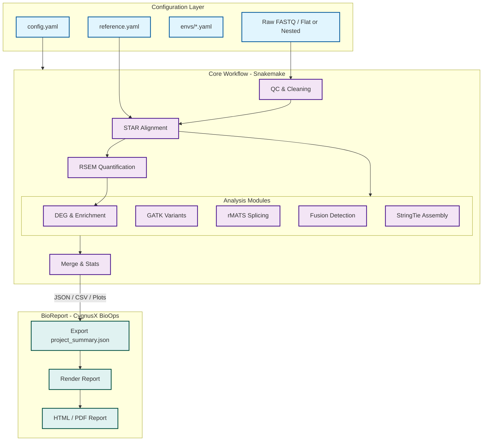

# 🏗️ Architecture & Project Layout

> Part of the [RNAFlow documentation](../README.md).

## 🏗️ System Architecture



### 🔄 Core Data Flow Description
1.  **Input Parsing**: `Snakemake` automatically reads `config.yaml` and identifies the input data structure.
2.  **Core Computation**: Expression matrices are obtained through STAR + RSEM, and advanced analysis modules are triggered in parallel.
3.  **Result Aggregation**: `13.deliver.smk` summarizes key results into the delivery directory.
4.  **Report Export**: `project_summary.json`, result tables, and plots are exported for the external [BioReport](https://github.com/xsx123123/bioreport) system (CygnusX BioOps), which renders the final HTML/PDF report.

## 📂 Project Organization Recommendations

To achieve decoupling of code and data, the following three-level directory structure is recommended for organizing analysis projects:

### 1. Top-level Project Directory
The root of the project, separating raw data, analysis processes, and final delivery:
```text
Project_Root/
├── 00.raw_data/             # Raw sequencer data (Read-only)
├── 01.workflow/             # Analysis workspace (Where Snakemake runs)
└── 02.data_deliver/         # Final result delivery directory (Automatically organized by the pipeline)
```

### 2. Analysis Working Directory (01.workflow)
Contains configuration files and serves as the current working directory for Snakemake:
```text
01.workflow/
├── config.yaml              # Project configuration (Specifies reference_path, etc.)
├── samples.csv              # Sample information table
├── contrasts.csv            # Differential analysis contrast table
├── 01.qc/                   # Intermediate QC results
├── 02.mapping/              # Intermediate alignment products (BAM, etc.)
├── 03.count/                # Intermediate quantification results
├── 07.AS/                   # Intermediate alternative splicing files
├── logs/                    # Detailed execution logs
└── benchmarks/              # Resource consumption statistics for each step
```

### 3. Result Delivery Directory (02.data_deliver)
Upon completion, the pipeline automatically summarizes core results here for final delivery:
```text
02.data_deliver/
├── 00_Raw_Data/             # Raw data summary
├── 01_QC/                   # QC reports (MultiQC, etc.)
├── 02_Mapping/              # Alignment statistical reports
├── 03_Expression/           # Expression quantification matrices
├── 05_DEG/                  # Differential expression analysis results
├── 06_Enrichments/          # Functional enrichment analysis charts
├── 07_AS/                   # Alternative splicing results
├── Summary/                 # Overall project summary statistics
├── Analysis_Report/         # Report output generated by external BioReport
├── report_data/             # Data exported for BioReport
└── delivery_manifest.json   # Delivery manifest and MD5 checksums
```

## 📂 Codebase Structure

```text
RNAFlow/
├── snakefile                # Main Snakemake entry file
├── config/                  # Configuration directory (Run parameters, reference genomes)
├── rules/                   # Modular rule definitions (01-14)
│   ├── 03.short_read_qc.smk # Quality control
│   ├── 06.mapping.smk       # Mapping
│   ├── 10.DEG_Enrichments.smk # Differential analysis and enrichment
│   ├── 13.deliver.smk       # Result organization
│   └── ...
├── envs/                    # Conda environment definition files (YAML)
├── container_env/           # 🆕 Container image builder (NEW in v0.1.9+)
│   ├── build_image.py       # Automated container builder with Rich logging
│   ├── images/              # Dockerfile templates
│   └── logs/                # Build logs
├── report/                  # BioReport submodule (CygnusX BioOps)
│                            # https://github.com/xsx123123/bioreport
├── skills/                  # AI Skills directory
│   ├── SKILL.md            # AI assistant skill definitions
│   ├── path_config.yaml    # Path configuration
│   ├── start_rnaflow.sh    # Enhanced startup script
│   ├── install_skills.sh   # General installation script
│   ├── install_codex_skills.sh # Codex-specific installation script
│   ├── examples/           # Configuration template examples
│   └── README.md           # Skills documentation
├── src/                     # Auxiliary script libraries (Python/R)
│   ├── DEG/                 # Differential analysis scripts
│   └── Enrichments/         # Enrichment analysis wrappers
└── scripts/                 # Utility scripts
```

---

[← Back to README](../README.md)
